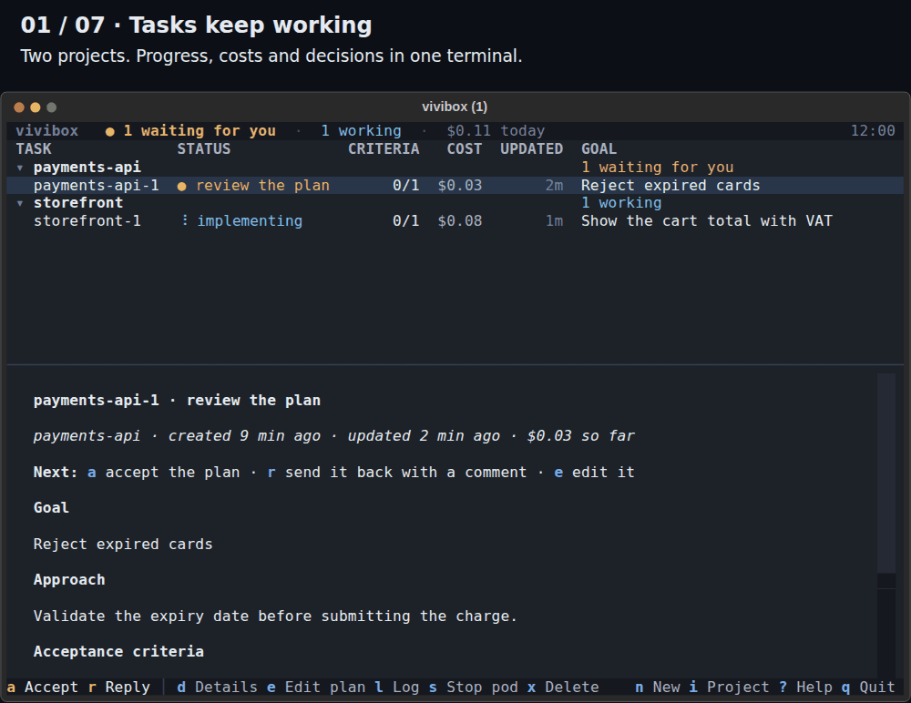

# vivibox

vivibox runs coding agents on tasks in isolated copies of your repositories. A planner proposes
a plan, you approve it, a writer implements it, vivibox verifies the commits, a reviewer reads
them, and you decide what reaches your checkout.

For developers already using Claude Code, Codex or OpenCode who want to hand off implementation
and come back for decisions. Plan with a strong model in your existing CLI subscription, then
let API models do the coding; choose who reviews each round.



*44-second tour of the real view: four flows, CLI planning and review, and your decisions.
Fictional tasks, simulated progress and illustrative costs.*
[Still view](docs/img/view.svg) · [Quick start](#quick-start) · [Documentation](#documentation)

**Where it stands.** v0.2.0 runs agents in [Sysbox](https://github.com/nestybox/sysbox)
containers on your Linux machine, not in virtual machines. It is a hardening release of that
architecture: it says in [security.md](docs/security.md) what it enforces, which test holds each
claim, and what it does not guarantee. Containers share the host's kernel, the internet is open
to the pod, and an MCP server you configure is trusted. VM isolation is future work.

## Why vivibox

A coding agent left alone will mark its own homework. vivibox manages the handoffs between
planning, implementation, verification and review, and keeps the roles apart:

- **Choose where the strong model works.** Use it once to plan, or keep it involved in every
  review. Each task can use a different flow and models.
- **Check the work before accepting it.** vivibox builds and tests the committed changes on a
  fresh clone, checks the acceptance criteria of the plan you accepted, commit subjects,
  disabled tests, invisible characters and recorded failing-test evidence. Failed checks and
  blocking review notes trigger bounded fix rounds.
- **Keep builds apart.** Each task's **pod** holds its clone and a Docker daemon of its own for
  Testcontainers and Compose. The host's Docker socket is never shared.
- **Leave tasks running.** Work continues with the view closed. Track several projects, inspect
  a review copy and ask for changes. Desktop notifications (off by default) or ntfy tell you
  when a task needs you.

## How it works

```text
Planner (P) → You approve the plan → Writer (W) → Gate → Reviewer (R) → You review and accept
                                        ↑          │        │
                                        └──────────┴────────┘
                                         failed checks / blocking notes
```

The planner, the writer and the reviewer are different trust roles, not just different prompts:

- **The writer** runs in the pod and is the only agent that executes project code. Its clone of
  your repository, the build tools and its own Docker daemon are there. It may use vivibox's
  built-in [Serena](https://github.com/oraios/serena) MCP server for symbol search on the
  writer's clone.
- **The planner** (in the Supervisor ⇄ Worker flow also the reviewer of every round) runs in a
  control container of its own, on a network of its own, with its own conversation store,
  server password and provider key, which the writer's container does not mount and cannot
  reach.
- **The reviewer** runs in a separate container, on its own network, made anew for every
  round, with only its own key.
- **Planner and reviewer never work from writer-controlled Git metadata.** vivibox makes a
  read-only copy of the task's commits on your host and mounts it in their containers; the
  writer's clone, its `.git` and its uncommitted work are not there. Their harness works in an
  empty directory vivibox made and loads no configuration, hook or MCP server the writer
  committed. Neither gets a language server or Serena in v0.2.0.
- **The gate** is mechanical verification: your build and test commands on a fresh clone of the
  commits, with the caches the writer can write mounted read-only. Each correction passes
  through it again; the default allows three fix rounds before you take over. Changes to build
  files, hooks and IDE settings need separate approval before the review copy opens.

### Choose a flow

Set **Flow** per task (`n`) or as a default (`k`). `+` shares a session and model. Every flow
includes verification, plan approval by default, and your final decision.

| Flow | Sessions and verification | Best for |
|---|---|---|
| **Single agent** | P+W+R → Gate | Small, routine tasks |
| **Planner → Executor** | P → W+R → Gate | A strong plan with cheaper execution |
| **Planner → Writer → Reviewer** · default | P → W → Gate → R | Independent review with automatic fix rounds |
| **Supervisor ⇄ Worker** | P → W → Gate → P+R | Keeping the planning context through complex changes |

The first two review their own work before verification. The default uses a separate reviewer
with a fresh conversation each review. Supervisor ⇄ Worker reuses the planning conversation to
review every round, including when you plan in your CLI. A Single agent task has no control
container: one agent plans and writes in one conversation. [Flow details](docs/tasks.md#orchestration-modes).

### Git history for the planner and the reviewer

The copies the planner and the reviewer read start with the last `history_depth` commits of
the task's branch (100 unless `config.toml` says otherwise) and always hold the task's base.
Your checkout is not made shallow or rewritten, and the writer's task clone keeps the whole
history of your checkout, as in 0.1.0.

A planner that needs an older commit writes its id to `/task/handoff/history-request.md` and
ends its turn. vivibox checks that each line is a commit id and nothing else, then deepens the
planner's copy in bounded steps: along the task's branch from the task's clone, and, only when
your own checkout is shallow and the task is on your own work, along your base branch from the
remote recorded when the task was made. The planner gets no fetch command, no ref or range, and
no PR refs. A commit that is not found or cannot be fetched is reported as that in
`/task/handoff/history.md`, so the planner does not guess. The reviewer's copy is never
deepened on request. [Older commits](docs/tasks.md#older-commits).

## What v0.2.0 ships

v0.2.0 is phase 0 of vivibox's security plan: hardening of the current Sysbox architecture,
not a new one. Compared with 0.1.0:

- the planner in a control container and network of its own; the reviewer on a network of its
  own; the three role networks refuse one another;
- host-made read-only copies of the commits for the planner and the reviewer, with bounded
  history and host-controlled deepening;
- a memory, process and CPU limit on every container of a task under one cgroup slice, and a
  disk image of the task's own that bounds what it writes outside its clone;
- the pod's egress rules on your host, loaded before the first packet, and a DNS forwarder on
  your host;
- the verification isolated from the caches the writer can write;
- host-side reading of agent-written files without following links or opening special files,
  hardened host git (time limits, a recorded `.git` layout, none of your shell's `GIT_*`);
- approvals bound to exactly what was shown, agent text rendered as text, submodule checks
  before accepting work;
- Serena for the writer, with usage reporting off.

Every change is in the [changelog](CHANGELOG.md).

## Quick start

**Alpha · Linux only.** Setup targets Ubuntu 24.04 on x86-64. Have Git (2.45, or a patched
older release named in [install.md](docs/install.md)),
[Docker Engine](https://docs.docker.com/engine/install/ubuntu/) usable without sudo
([post-install steps](https://docs.docker.com/engine/install/linux-postinstall/)), not the snap
package or Docker Desktop, which Sysbox cannot run under, and a model API key or an
`opencode.json` to import.

```bash
git clone https://github.com/DEVividious/vivibox.git
cd vivibox
host/setup.sh            # lists changes, then asks before applying them
host/setup.sh --check    # read-only; exits 1 if setup is incomplete
vivibox                  # open the view; the first launch builds the agent image
```

Setup asks before changing Sysbox, Docker networking, the rules on your machine for the pods'
network, host tools or task storage; it may restart Docker. It also installs or updates the
vivibox skill for installed Claude Code and Codex CLIs. After an update that changes the image,
run `vivibox image build`. [Installation and uninstall](docs/install.md).

In the view:

1. **Configure:** `k` → **Providers & MCP** → add a provider or import `opencode.json`.
2. **Create:** `i` adds a repository; `n` describes a task and chooses its flow and models.
   Pick a **Planner** model for automatic planning; initially it is **you, in your own chat**.
3. **Approve:** `d` shows the plan; `a` accepts it. If verification has no command yet, its
   proposed command needs your approval at a separate checkpoint.
4. **Review:** `f` shows the diff, `o` opens the review copy, `r` asks for changes, `p`
   approves risky files exactly as shown. `a` applies the work; a separate dialog offers a
   branch and commit message.

The same from a shell:

```bash
cd ~/projects/myproject
vivibox init                                      # proposes the project's verify command
vivibox new myproject "Add unit tests for OrderValidator"
vivibox status <id>                               # where the task is and what it needs
vivibox accept <id>                               # the plan, the command, or the work
vivibox reply <id> "use the existing fixture"     # ask for changes or answer a question
```

[Tasks, flows and commands](docs/tasks.md).

### Plan in Claude Code or Codex

After provider setup, open your agent's CLI in the project's repository and ask:

> Use the vivibox skill to add CSV export. Plan it with me, then hand implementation to vivibox.

In Claude Code, `/vivibox` invokes the skill directly. The skill uses `vivibox info`, creates a
task with `vivibox new --plan-in-cli`, brings your approved plan in with `vivibox plan import`,
and follows it with `vivibox wait`. With **Supervisor ⇄ Worker**, that CLI also reviews every
round using `vivibox review <id> --prompt` and `--import`. You still approve the plan, risky
changes and final work. **Single agent** needs an automatic planner; CLI planning supports the
other flows. [CLI workflow and skill setup](docs/tasks.md#driving-vivibox-from-an-agents-cli).

## What it protects, and what it does not

**Enforced in v0.2.0.** The [table in security.md](docs/security.md#what-is-enforced-and-what-holds-it)
names the mechanism and the test that holds each claim of the boundary:

- The host reads nothing through a link, FIFO or device an agent planted, in `handoff/` or in
  the clone; git the host runs in the clone is bounded in time, runs only while the clone's
  `.git` is as recorded, and gets none of the `GIT_*` of your shell.
- Each agent's container holds the keys of its role alone, on a read-only tmpfs: the writer
  has neither the reviewer's nor the planner's.
- The planner and the reviewer each run in a container and a network of their own, read a
  host-made read-only copy of the commits, and load nothing the writer committed.
- From the pod, your host, your LAN, private ranges, other tasks, IPv6 and UDP other than DNS
  are refused by rules on your host, loaded before a workload starts; the writer's, reviewer's
  and planner's networks refuse one another; root in the pod cannot remove the rules.
- Every container of a task runs with a memory, process and CPU limit under the task's cgroup
  slice; what the task writes outside its clone is on a disk image of its own size.
- The verification runs nothing from the shared caches and writes nothing into them.
- Accepting work is refused while a submodule commit it keeps is kept by no repository of
  yours.
- `p` approves only the risky files on the screen, as shown; a file that cannot be shown whole
  is covered by no approval; a command the writer proposes is kept only after the gate passed
  with it.
- Text an agent wrote is shown as text: no link opens, no markup is read, invisible characters
  appear as code points.
- Tasks from 0.1.0 are shown, never run or rewritten (see below).

**Not guaranteed in v0.2.0.** The full list is in
[Limits of the boundary](docs/security.md#limits-of-the-boundary-what-vivibox-does-not-guarantee):

- **Containers, not virtual machines.** Pods share the host's kernel under Sysbox. A kernel
  flaw reachable from a container is reachable from a pod.
- **The internet is open.** No allow-list of names or addresses; the DNS forwarder applies no
  policy, and DNS over HTTPS is not stopped. A task can send what it reads anywhere.
- **Keys are in the pod.** Every provider key enabled for an agent is in that agent's
  container, readable by it; a provider two roles share is in both containers.
- **An MCP server you configured is trusted.** It runs in the container of each agent you gave
  it to, with the secrets you named. vivibox does not claim to sandbox a malicious MCP server
  from the planner.
- **`handoff/` is shared.** The writer and the planner both write it; the writer can replace the
  planner's draft or question before vivibox reads it. The draft comes to you to read.
- **The planner reads the repository as data, by its brief, not by enforcement.** It can be
  misled by what a file says.
- **Network rules hold for what vivibox starts.** They do not survive a reboot; a pod container
  you start by hand with `docker start` afterwards runs without them until the task's next
  `vivibox start`.
- **No code intelligence for the planner.** On a large repository it reads files and searches
  with its harness's own tools.
- **Residual Git-history details.** A deepening step from your remote may leave objects of
  newer base-branch commits in the planner's copy's store, unreachable from its HEAD but
  readable by id; a project JDK the writer's mise installed is the one the gate runs.

## Upgrading from v0.1.0

Upgrading the installation is supported: pull, run `host/setup.sh` again (the root helper
changed and the pods' rules moved to your machine), run `uv tool install --force --editable .`
for the new dependencies, and let the first start rebuild the agent image.

Tasks created by 0.1.0 use an older task layout and are not migrated. They stay visible in the
list and in `vivibox status` as **from an earlier vivibox**; `vivibox start` or `resume` on one
is refused with that explanation. Delete such a task with `vivibox delete <id>` and create it
again. vivibox never rewrites or silently destroys their state.

## Future work

- A VM per host with Sysbox in the guest, so the kernel is no longer shared.
- Code intelligence for the planner on large repositories.
- Further controlled history improvements, starting with the residual objects noted above.
- A domain allow-list for egress and keys that leave the pod.

## Documentation

- [Providers, models and project configuration](docs/configure.md)
- [Tasks, flows, CLI commands and logs](docs/tasks.md)
- [Isolation, verification and security boundaries](docs/security.md)
- [Development and reproducing the tour](CONTRIBUTING.md)

[Changelog](CHANGELOG.md) · [MIT license](LICENSE)
